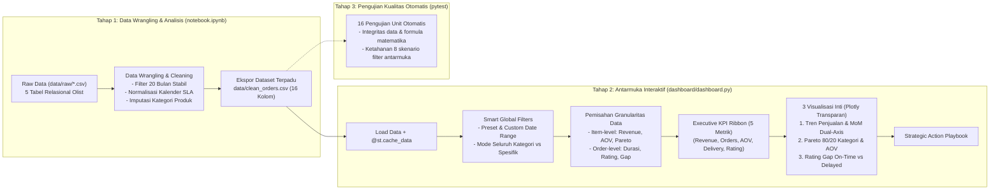

# 🏗️ System Architecture & Technical Design

Dokumentasi arsitektur sistem, alur pemrosesan data (*data pipeline*), dan pertimbangan desain teknis (*Architecture Decision Records*) pada proyek E-Commerce Insight Dashboard.

---

## 1. Arsitektur Alur Kerja (*Workflow Architecture*)

Sistem dibangun dengan arsitektur dua tahap (*two-tier pipeline*) yang memisahkan secara modular antara penyiapan data analitis dengan penyajian antarmuka interaktif:

---

## 2. Catatan Keputusan Arsitektur (*Architecture Decision Records*)

### ADR-01: Pemisahan Pipeline Dua Tahap (*Two-Tier Pipeline*)
* **Konteks:** Menjalankan pembersihan dan penggabungan 5 tabel relasional mentah secara langsung di dalam aplikasi dashboard akan membebani memori dan memperlambat waktu respons pengguna.
* **Keputusan:** Seluruh proses *data wrangling*, audit nilai hilang, rekayasa fitur, dan validasi statistik dijalankan di `notebook.ipynb`. Hasilnya diekspor ke satu file dataset bersih terpadu: `data/clean_orders.csv`. Dashboard Streamlit hanya bertugas membaca file bersih tersebut menggunakan `@st.cache_data`.
* **Dampak Positif:** Waktu pemuatan awal dashboard berada di bawah 2 detik, memori server efisien, dan proses pembersihan data terdokumentasi secara transparan serta mudah diaudit.

### ADR-02: Format Penyimpanan Dataset Bersih Menggunakan CSV Standar
* **Konteks:** Menjaga portabilitas proyek tanpa memerlukan ketergantungan library pembaca format biner khusus.
* **Keputusan:** Menggunakan format CSV standar (`data/clean_orders.csv`).
* **Dampak Positif:** Universal, dapat dibuka di berbagai *environment* (Jupyter, VS Code, spreadsheet), dan kompatibel langsung dengan Streamlit Cloud deployment.

### ADR-03: Visualisasi Interaktif Menggunakan Plotly Express & Subplots Transparan
* **Konteks:** Visualisasi statis (Matplotlib/Seaborn) kurang fleksibel untuk eksplorasi dinamis, sedangkan kanvas putih keras menyebabkan benturan kontras saat pengguna membuka dashboard dalam mode gelap (*Dark Mode*).
* **Keputusan:** Menggunakan **Plotly Express** dan `plotly.graph_objects.make_subplots` untuk grafik berskala ganda. Seluruh figur dikonfigurasi dengan latar belakang transparan (`rgba(0,0,0,0)`), margin sumbu Y dinamis, serta tipografi Inter terpadu.
* **Dampak Positif:** Visualisasi modern, responsif terhadap perubahan ukuran layar, dan beradaptasi mulus dengan tema gelap maupun terang.

### ADR-04: Normalisasi Tanggal Kalender untuk Pengukuran Keterlambatan SLA
* **Konteks:** Pada dataset Olist, tanggal estimasi tersimpan pada pukul `00:00:00`. Pengurangan langsung antar-*timestamp* menyebabkan pesanan yang tiba siang/sore hari pada tanggal estimasi keliru diklasifikasikan sebagai pesanan terlambat.
* **Keputusan:** Normalisasikan kedua *timestamp* ke tanggal kalender murni (`.dt.floor('D')`) sebelum menghitung selisih hari keterlambatan (`delay_days`).
* **Dampak Positif:** Menghilangkan bias klasifikasi pada 1.292 pesanan yang sebenarnya tiba tepat waktu, menghasilkan perhitungan *Satisfaction Gap* dan proporsi ulasan buruk yang akurat secara objektif.

### ADR-05: Pemisahan Granularitas Item-Level dan Order-Level di Dashboard
* **Konteks:** Satu pesanan unik dapat berisi beberapa barang (*multi-item orders*). Menghitung skor ulasan atau durasi pengiriman langsung dari baris item akan memberikan bobot ganda (*duplicate weighting*) pada pesanan dengan banyak barang, mendistorsi analisis kepuasan pelanggan.
* **Keputusan:** Menghitung omset dan kontribusi produk pada level item transaksi, sedangkan durasi logistik, ketepatan waktu, dan skor ulasan dievaluasi strictly pada level pesanan unik (`df_filtered.drop_duplicates(subset=['order_id'])`).
* **Dampak Positif:** Menghindari bias statistik dan menjamin keakuratan koefisien korelasi riil antara logistik dan kepuasan pelanggan.
