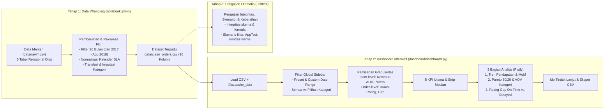

# Arsitektur Sistem & Desain Teknis

Dokumentasi alur pemrosesan data dan keputusan arsitektur (*Architecture Decision Records*) pada proyek E-Commerce Insight Dashboard.

## 1. Alur Kerja Sistem

Proyek menggunakan arsitektur dua tahap yang memisahkan persiapan data analitis dari penyajian dashboard interaktif:

## 2. Architecture Decision Records

### ADR-01: Pemisahan Pipeline Dua Tahap
- **Konteks:** Menggabungkan dan membersihkan lima tabel relasional mentah langsung di dalam aplikasi web membebani memori serta memperlambat rendering awal.
- **Keputusan:** Proses pembersihan data, deduplikasi ulasan, dan rekayasa fitur dijalankan di `notebook.ipynb`, lalu diekspor ke `data/clean_orders.csv`. Aplikasi Streamlit membaca dataset bersih tersebut dengan `@st.cache_data`.
- **Dampak:** Aplikasi hanya membaca satu file CSV terstruktur dengan cache aktif, sementara seluruh langkah transformasi data terdokumentasi di notebook untuk audit ulang.

### ADR-02: Penyimpanan Dataset Bersih dalam Format CSV
- **Konteks:** Proyek perlu tetap portabel lintas lingkungan tanpa ketergantungan pembaca biner khusus.
- **Keputusan:** Menggunakan CSV standar (`data/clean_orders.csv`).
- **Dampak:** Dapat dibuka langsung di Jupyter, editor teks, maupun spreadsheet, serta kompatibel tanpa konfigurasi tambahan di Streamlit Cloud.

### ADR-03: Antarmuka Dark Slate & Visualisasi Plotly Transparan
- **Konteks:** Grafik statis kurang mendukung eksplorasi filter, sedangkan warna latar grafik yang kaku bentrok dengan tema gelap aplikasi.
- **Keputusan:** Menggunakan Plotly Express dan `make_subplots` dengan latar transparan (`rgba(0,0,0,0)`), di atas sistem visual dark slate (`ENERGY 1 / RHYTHM 2 / MOTION 1`):
  - **Palet:** `#0F172A` sebagai kanvas dan `#1E293B` untuk kartu agar seri data berlatar gelap terbaca kontras, dengan `#38BDF8` sebagai aksen utama grafik/fokus serta `#10B981`/`#EF4444` khusus untuk status tepat waktu vs terlambat.
  - **Tipografi:** Font `Inter` dengan `tabular-nums` untuk keterbacaan angka dan label sumbu pada layar padat data.
  - **Layout & Komposisi:** Pita KPI di atas diikuti tiga bagian analitis (tren waktu, Pareto 80/20, dampak pengiriman) agar pembacaan bergerak dari ringkasan eksekutif ke akar masalah.
- **Dampak:** Seluruh pasangan teks dan kartu memenuhi kontras WCAG AA, warna semantik tidak tercampur hiasan dekoratif, dan visualisasi merespons filter tanpa tabrakan tema.

### ADR-04: Normalisasi Tanggal Kalender untuk SLA Pengiriman
- **Konteks:** Kolom `order_estimated_delivery_date` pada dataset Olist tersimpan pada pukul `00:00:00`. Perbandingan langsung antar-timestamp membuat pesanan yang tiba siang hari pada tanggal estimasi tercatat terlambat.
- **Keputusan:** Melakukan normalisasi kedua timestamp ke tanggal kalender (`.dt.floor('D')`) sebelum menghitung `delay_days`.
- **Dampak:** Mengoreksi status `1,291` pesanan yang sebenarnya tiba pada tanggal estimasi, sehingga perhitungan *Satisfaction Gap* dan persentase ulasan bintang 1 tetap akurat.

### ADR-05: Pemisahan Granularitas Item-Level dan Order-Level
- **Konteks:** Satu pesanan dapat memuat beberapa item produk. Menghitung durasi pengiriman atau skor ulasan langsung dari baris item memberi bobot ganda pada pesanan multi-item.
- **Keputusan:** Menghitung pendapatan dan kontribusi kategori pada level item, sementara durasi kirim, ketepatan waktu, dan rating dievaluasi pada level `order_id` unik (`drop_duplicates(subset=['order_id'])`).
- **Dampak:** Mencegah distorsi statistik korelasi dan menjaga akurasi metrik kepuasan pelanggan.
