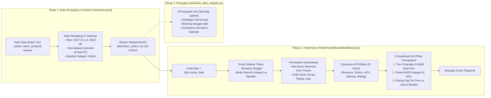

# SPECIFICATION: System Architecture & Technical Design (Simplified)

**Project:** E-Commerce Insight Dashboard  
**Status:** Approved & Verified (100%)  
**Version:** 2.1.0 (Audited & Synchronized)  
**North Star Reference:** `PROJECT_CONTEXT.md` & `specs/requirements.md`

---

## 1. Arsitektur Alur Kerja (Workflow Architecture)

Sistem dirancang dengan arsitektur dua tahap (*two-tier workflow*) yang transparan, mudah dipahami, dan langsung dapat dijelaskan oleh seorang Junior Data Analyst:



---

## 2. Architecture Decision Records (ADRs)

### ADR-001: Alur Kerja Dua Tahap (Notebook ke Clean CSV ke Dashboard)
- **Konteks:** Menghindari sistem multi-modul yang terlalu rumit bagi *fresh graduate*, namun tetap memisahkan proses penyiapan data dari proses penyajian visual.
- **Keputusan:** Seluruh logika pembersihan data, eksplorasi awal, dan pengujian formula dilakukan secara transparan di dalam `notebook.ipynb`. Hasil akhirnya diekspor ke satu file bersih terpadu: `data/clean_orders.csv` (109.872 baris dan 16 kolom). Dashboard Streamlit hanya bertugas membaca file CSV bersih ini.
- **Justifikasi Interview:** Menunjukkan kemampuan *data cleaning workflow* yang rapi dan terisolasi tanpa membebani performa aplikasi dashboard.

### ADR-002: Format Penyimpanan Dataset Bersih Menggunakan CSV Standar
- **Konteks:** Menghindari format biner seperti Parquet yang memerlukan library tambahan dan lebih sulit diinspeksi langsung.
- **Keputusan:** Gunakan format CSV standar (`clean_orders.csv`).
- **Justifikasi Interview:** Format CSV universal, dapat dibuka di Excel/VS Code untuk verifikasi manual, dan sangat intuitif saat didiskusikan dengan pewawancara.

### ADR-003: Mesin Visualisasi Menggunakan Plotly Express & Subplots Transparan
- **Konteks:** Visualisasi lama menggunakan Matplotlib/Seaborn statis, sementara grafik Plotly dengan latar belakang putih keras (`#FFFFFF`) menyebabkan benturan tema (*theme clash*) pada Dark Mode. Skala ganda (Revenue di angka jutaan vs Orders di ribuan) juga memerlukan sumbu sekunder.
- **Keputusan:** Gunakan **Plotly Express** dikombinasikan dengan `make_subplots` (Plotly Graph Objects) untuk grafik skala ganda. Terapkan latar belakang transparan (`rgba(0,0,0,0)`) dan margin kiri yang memadai ($75\text{ px}$) agar sumbu Y tidak terpotong.
- **Justifikasi Interview:** Menghasilkan grafik modern yang interaktif, responsif, dan otomatis beradaptasi mulus pada mode gelap maupun terang.

### ADR-004: Normalisasi Tanggal Kalender untuk Pengukuran Keterlambatan SLA
- **Konteks:** Di dataset Olist, tanggal estimasi pengiriman tersimpan pada jam `00:00:00`. Pengurangan timestamp langsung menyebabkan pesanan yang tiba pada sore hari di tanggal estimasi salah diklasifikasikan sebagai pesanan terlambat.
- **Keputusan:** Normalisasikan kedua tanggal ke tingkat tanggal kalender (`.dt.floor('D')`) sebelum menghitung `delay_days`.
- **Justifikasi Interview:** Menunjukkan ketelitian bisnis dalam menginterpretasikan SLA operasional: pelanggan menganggap paket tiba tepat waktu selama barang sampai pada tanggal yang dijanjikan.

### ADR-005: Pemisahan Granularitas Item-Level dan Order-Level di Dashboard
- **Konteks:** Mengagregasi metrik ulasan dan waktu pengiriman langsung dari baris item menyebabkan pesanan dengan banyak barang memiliki bobot berlebih.
- **Keputusan:** Hitung metrik logistik dan ulasan pada level pesanan unik (`df_filtered.drop_duplicates(subset=['order_id'])`).
- **Justifikasi Interview:** Menunjukkan pemahaman konsep *entity-relationship modeling* dan pencegahan bias statistik saat menangani relasi *one-to-many*.

---

## 3. Struktur File Proyek

```
PROJECT 1 (E-COMMERCE INSIGHT DASHBOARD)/
├── .streamlit/
│   └── config.toml               # Konfigurasi tema gelap terpadu
├── data/
│   ├── (raw data: orders, items, products, reviews, etc.)
│   └── clean_orders.csv          # Dataset tunggal hasil olahan & pembersihan (16 kolom)
│
├── dashboard/
│   ├── dashboard.py              # File utama Streamlit (Plotly Express + Subplots)
│   └── style.css                 # Styling CSS modern, adaptif, & anti-bentrok tema
│
├── tests/
│   ├── __init__.py
│   └── test_data_integrity.py    # 8 pengujian otomatis integritas data & formula
│
├── notebook.ipynb                # Notebook analisis data lengkap & berurutan
├── requirements.txt              # Dependensi: streamlit, pandas, numpy, plotly, matplotlib, seaborn, pytest
├── README.md                     # Dokumentasi portofolio profesional siap publikasi
├── PROJECT_CONTEXT.md            # Living context file (North Star)
│
└── specs/                        # Spec-Driven Development (SDD)
    ├── requirements.md           # Kebutuhan bisnis, formula, & kriteria penerimaan
    ├── design.md                 # Arsitektur sistem & ADR (Dokumen ini)
    ├── tasks.md                  # Roadmap & checklist pengerjaan
    └── steering.md               # Batasan ruang lingkup & pedoman interview
```

---

## 4. Skema Kolom `data/clean_orders.csv` (16 Kolom)

| Kolom | Tipe Data | Deskripsi |
| :--- | :--- | :--- |
| `order_id` | `object` | ID unik pesanan |
| `order_status` | `object` | Status pesanan (`delivered`) |
| `order_purchase_timestamp` | `datetime64` | Waktu pembelian dilakukan |
| `order_delivered_customer_date` | `datetime64` | Waktu pesanan sampai di tangan pelanggan |
| `order_estimated_delivery_date` | `datetime64` | Estimasi batas waktu pengiriman |
| `order_year_month` | `object` | Periode tahun-bulan (format: YYYY-MM) |
| `product_id` | `object` | ID produk |
| `product_category_name_english` | `object` | Kategori produk terjemahan bahasa Inggris (72 kategori) |
| `price` | `float64` | Harga barang (BRL) |
| `freight_value` | `float64` | Ongkos kirim (BRL) |
| `total_order_value` | `float64` | Nilai total item (`price + freight_value`) |
| `actual_delivery_days` | `float64` | Durasi pengiriman riil (hari) |
| `estimated_delivery_days` | `float64` | Durasi estimasi pengiriman (hari) |
| `delay_days` | `float64` | Hari keterlambatan kalender terhadap tanggal estimasi |
| `is_delayed` | `bool` | Indikator keterlambatan (`True` jika terlambat kalender) |
| `review_score` | `float64` | Skor ulasan kepuasan pelanggan (skala 1–5) |

---

## 5. Tata Letak Dashboard Streamlit (`dashboard.py`)

1. **Header & Context Banner:** Judul proyek, tujuan bisnis, dan keterangan rentang data (Januari 2017 – Agustus 2018).
2. **Sidebar Controls Cerdas:**
   - Filter rentang waktu (`st.sidebar.date_input`).
   - Toggle *"Analisis Seluruh Kategori (72 Kategori)"* untuk mencegah banjir chip tag merah. Multiselect hanya muncul saat toggle dinonaktifkan.
3. **Executive KPI Ribbon (5 Kartu):**
   - 💰 Total Net Revenue (BRL)
   - 📦 Total Delivered Orders
   - 🏷️ Average Order Value / AOV (BRL)
   - 🚚 Avg Delivery Time (Hari) (Delta: Median Delivery Time)
   - ⭐ Avg Review Score (Bintang) (Delta: On-Time Delivery Rate %)
4. **Card 1: Tren Pendapatan & Pertumbuhan Bulanan (MoM):**
   - Grafik garis ganda: Revenue vs Total Orders dengan anotasi otomatis Black Friday Nov 2017.
   - Grafik batang pertumbuhan MoM % dengan penanganan anggun bulan pertama.
5. **Card 2: Analisis Portofolio Kategori & Pareto 80/20:**
   - Grafik batang Top Kategori Produk dengan pembedaan visual Core 80% (18 kategori) vs Long-tail.
   - Grafik batang horizontal AOV per kategori produk.
6. **Card 3: Dampak Durasi Pengiriman terhadap Skor Ulasan Pelanggan:**
   - Grafik perbandingan rata-rata rating pesanan *On-time* (4,29 ⭐) vs *Late* (2,27 ⭐).
   - Boxplot sebaran durasi pengiriman per tingkat rating bintang (0–45 hari).
7. **Card 4: Strategic Action Playbook:**
   - Rekomendasi konkret untuk strategi komersial, merchandising kategori unggulan, dan operasional logistik.
